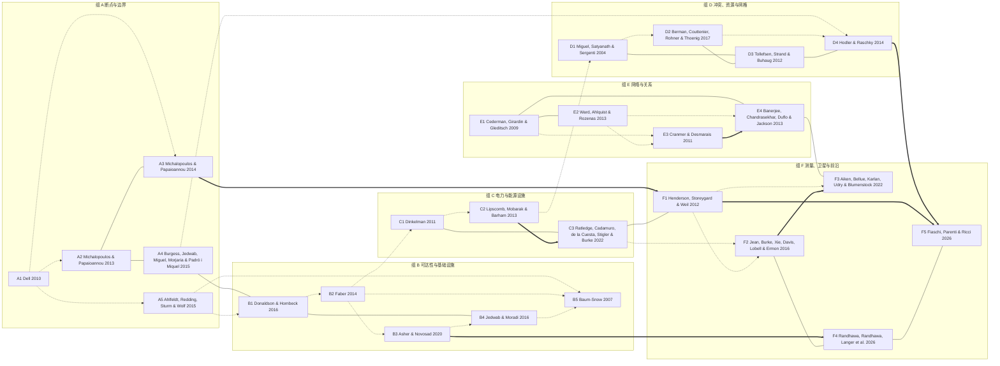

# 地理量化文献知识库

## 分组

| 组 | 名称 | 篇数 | 索引文件 | 共同识别逻辑 |
| --- | --- | --- | --- | --- |
| A | 断点与边界 | 5 | [[01-group-A-断点与边界]] | 把一条画在地图上的线当作外生分界。线两侧的地理条件连续，制度或干预在线上跳变。 |
| B | 可达性与基础设施 | 5 | [[02-group-B-可达性与基础设施]] | 把路网换成成本矩阵，用最短路或市场准入衡量区位的相对优劣。工程规划的时间差提供识别来源。 |
| C | 电力与能源设施 | 3 | [[03-group-C-电力与能源设施]] | 电网扩张的落点由地形、河流落差与行政批次决定。这些落点与当地经济潜力弱相关。 |
| D | 冲突、资源与网格 | 4 | [[04-group-D-冲突资源与网格]] | 把世界切成等面积方格。外部价格冲击乘上本地资源禀赋，得到随格子与时期变动的影响强度。 |
| E | 网络与关系 | 4 | [[05-group-E-网络与关系]] | 把行为体与联系写成矩阵。中心性、指数随机图与潜在空间把关系结构参数化。 |
| F | 测量、卫星与前沿 | 5 | [[06-group-F-测量卫星与前沿]] | 把不可直接观测的经济量用可观测信号代理。代理关系本身是检验对象，不是论证前提。 |

## 文献一览

| 编号 | 简称 | 年份 | 期刊 | 观测单元 | 识别策略 | 数据形态 | 卡片 |
| --- | --- | --- | --- | --- | --- | --- | --- |
| A1 | Dell 2010 | 2010 | Econometrica | 秘鲁县（distrito），并以经纬度计算到 Mita 边界的距离 | 空间断点回归 | 混合 | [[A1-dell]] |
| A2 | Michalopoulos & Papaioannou 2013 | 2013 | Econometrica | 族群家园多边形（ethnic homeland）与网格单元 | 空间断点＋边界固定效应 | 混合 | [[A2-michalopoulos]] |
| A3 | Michalopoulos & Papaioannou 2014 | 2014 | Quarterly Journal of Economics | 国界两侧二十五公里带宽内的网格单元 | 跨国界空间断点 | 栅格 | [[A3-michalopoulos]] |
| A4 | Burgess, Jedwab, Miguel, Morjaria & Padró i Miquel 2015 | 2015 | American Economic Review | 肯尼亚道路分段（road segment）与相邻选区 | 双重差分 | 线 | [[A4-burgess]] |
| A5 | Ahlfeldt, Redding, Sturm & Wolf 2015 | 2015 | Econometrica | 柏林地块（block）级微观地理单元 | 空间断点＋结构模型 | 面 | [[A5-ahlfeldt]] |
| B1 | Donaldson & Hornbeck 2016 | 2016 | Quarterly Journal of Economics | 美国县（county） | 市场准入＋结构模型 | 线 | [[B1-donaldson]] |
| B2 | Faber 2014 | 2014 | Review of Economic Studies | 中国县（county） | 双重差分＋工具变量 | 混合 | [[B2-faber]] |
| B3 | Asher & Novosad 2020 | 2020 | American Economic Review | 印度村庄（village） | 双重差分＋事件研究 | 点 | [[B3-asher]] |
| B4 | Jedwab & Moradi 2016 | 2016 | Review of Economics and Statistics | 加纳的城镇与村落点位 | 准外生路线的长期比较 | 点 | [[B4-jedwab]] |
| B5 | Baum-Snow 2007 | 2007 | Quarterly Journal of Economics | 美国大都市统计区与其中心城 | 工具变量 | 线 | [[B5-baum-snow]] |
| C1 | Dinkelman 2011 | 2011 | American Economic Review | 南非农村社区（community） | 工具变量＋固定效应 | 点 | [[C1-dinkelman]] |
| C2 | Lipscomb, Mobarak & Barham 2013 | 2013 | American Economic Journal: Applied Economics | 巴西自治市（municipality） | 工具变量 | 混合 | [[C2-lipscomb]] |
| C3 | Ratledge, Cadamuro, de la Cuesta, Stigler & Burke 2022 | 2022 | Nature | 乌干达村庄 | 双重稳健机器学习去偏 | 栅格 | [[C3-ratledge]] |
| D1 | Miguel, Satyanath & Sergenti 2004 | 2004 | Journal of Political Economy | 撒哈拉以南非洲国家—年 | 面板工具变量 | 栅格 | [[D1-miguel]] |
| D2 | Berman, Couttenier, Rohner & Thoenig 2017 | 2017 | American Economic Review | 非洲零点五度网格单元—月 | 三重差分 | 栅格 | [[D2-berman]] |
| D3 | Tollefsen, Strand & Buhaug 2012 | 2012 | Journal of Peace Research | 全球零点五度经纬网格（约五十五公里见方） | 数据基础设施 | 栅格 | [[D3-tollefsen]] |
| D4 | Hodler & Raschky 2014 | 2014 | Quarterly Journal of Economics | 夜光栅格像素与族群聚居区 | 三重差分＋多层固定效应 | 栅格 | [[D4-hodler]] |
| E1 | Cederman, Girardin & Gleditsch 2009 | 2009 | World Politics | 政府—族群—外部亲缘族群构成的三元组 | 三元组逻辑斯蒂回归 | 关系边 | [[E1-cederman]] |
| E2 | Ward, Ahlquist & Rozenas 2013 | 2013 | Network Science | 国家对—年 | 动态潜在空间模型 | 关系边 | [[E2-ward]] |
| E3 | Cranmer & Desmarais 2011 | 2011 | Political Analysis | 国际组织成员国之间的双边联系 | 指数随机图模型 | 关系边 | [[E3-cranmer]] |
| E4 | Banerjee, Chandrasekhar, Duflo & Jackson 2013 | 2013 | Science | 印度村庄内的家庭—家庭关系边 | 网络中心性＋工具变量 | 关系边 | [[E4-banerjee]] |
| F1 | Henderson, Storeygard & Weil 2012 | 2012 | American Economic Review | 国家—年与次国家区域 | 测量误差模型 | 栅格 | [[F1-henderson]] |
| F2 | Jean, Burke, Xie, Davis, Lobell & Ermon 2016 | 2016 | Science | 非洲五国的小区域（约村级） | 两阶段迁移学习 | 栅格 | [[F2-jean]] |
| F3 | Aiken, Bellue, Karlan, Udry & Blumenstock 2022 | 2022 | Nature | 多哥的移动电话用户（个体） | 预测模型＋瞄准误差比较 | 混合 | [[F3-aiken]] |
| F4 | Randhawa, Randhawa, Langer et al. 2026 | 2026 | Nature Communications | 九百万公里主干道的路段 | 多尺度描述与相关分析 | 线 | [[F4-randhawa]] |
| F5 | Fiaschi, Parenti & Ricci 2026 | 2026 | arXiv 预印本 | 行政单元（不同聚合层级） | 反向回归分解 | 栅格 | [[F5-fiaschi]] |

## 交叉引用图

实线为数据形态相同，点线为识别逻辑相同，粗箭头为互为稳健性检验。

## 引用关系统计

| 组 | 组内边 | 跨组边（按本组端点计） | 卡片数 |
| --- | --- | --- | --- |
| A | 5 | 5 | 5 |
| B | 6 | 5 | 5 |
| C | 3 | 4 | 3 |
| D | 5 | 3 | 4 |
| E | 6 | 1 | 4 |
| F | 6 | 6 | 5 |

全文共 43 条关联边，其中跨组 12 条，组内 31 条。
